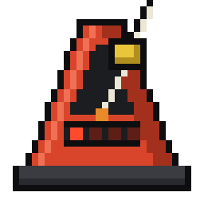
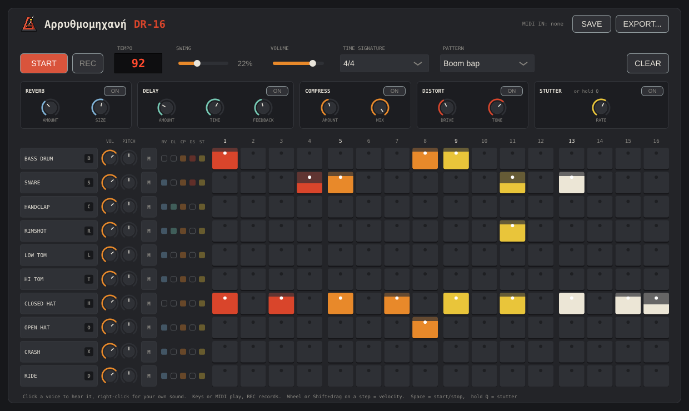

# Arrhythmetic

**Αρρυθμομηχανή** in Greek: the word for calculator, *αριθμομηχανή*, with one extra ρ, which makes it a machine with no rhythm. The English name keeps the joke: arithmetic + arrhythmic.

A desktop drum machine built with JUCE: 10 voices, up to 32 steps, odd time signatures, and five effects (reverb, delay, compression, distortion, stutter). The built-in sounds are synthesized in real time in an 808 style; any voice can be swapped for your own audio file. Play it from the computer keyboard or a MIDI controller, and export to WAV or MIDI.

## Build

You need CMake 3.22+, Git, and a C++17 compiler. JUCE is downloaded automatically on the first configure (takes a minute or two).

**Windows** (Visual Studio 2022 with "Desktop development with C++"): double-click **`build.bat`**. It builds the app and starts it. The first build downloads JUCE and takes a few minutes; later ones only recompile what changed. Or, by hand:

    cmake -B build
    cmake --build build --config Release

The app ends up in `build\Arrhythmetic_artefacts\Release\Arrhythmetic.exe`.

**macOS** (Xcode command line tools):

    cmake -B build -DCMAKE_BUILD_TYPE=Release
    cmake --build build -j

The app is `build/Arrhythmetic_artefacts/Release/Arrhythmetic.app`.

**Linux** (Debian/Ubuntu):

    sudo apt install build-essential cmake git libasound2-dev libfreetype-dev \
        libfontconfig1-dev libx11-dev libxrandr-dev libxinerama-dev libxcursor-dev \
        libxext-dev libxcomposite-dev
    cmake -B build -DCMAKE_BUILD_TYPE=Release
    cmake --build build -j

Run `build/Arrhythmetic_artefacts/Release/Arrhythmetic`.

## Use

- Click a step to toggle it; drag along a row to paint or erase several.
- Click a voice name to hear it, **M** to mute the track.
- **Tempo:** click the red display and type a number (20-400), Enter to confirm. Up/Down arrows nudge it by 1, Shift+Up/Down by 10. Tempo is always quarter-note BPM.
- **Time signature:** pick it from the menu. The grid is 16th notes, so 7/4 = 28 steps, 9/8 = 18 steps. Colours show how the bar is counted (7/8 as 2+2+3 etc.).
- **Your own sounds:** right-click a voice name and choose "Load sound...", or drag a WAV/AIFF/FLAC/OGG/MP3 onto it. "Use built-in sound" goes back to the synth. Loaded sounds are remembered between sessions.
- **Play from the keyboard:** B bass drum, S snare, C clap, R rim, L low tom, T hi tom, H closed hat, O open hat, X crash, D ride (the key is shown on each voice).
- **Record:** arm **REC**, start the beat and play the keys; each hit is written to the nearest step.
- **Velocity (dynamics):** every step has its own velocity, shown by how far the step is filled: full = accent, about 80% = normal, a short fill = ghost note. Roll the mouse wheel over a lit step, or Shift+drag it up/down, to change it; the value shows as a MIDI number (1-127). Hits from a MIDI keyboard are recorded with the velocity you played; computer keys record at normal. Softer hits are quieter and a little darker, like a drum struck gently.
- **Volume and pitch per sound:** the two knobs next to each name. Pitch is in semitones (-12 to +12) and works on built-in and loaded sounds. Drag up/down to turn, double-click to reset. Letting go plays the sound so you hear the change.
- **Effects:** the panel at the top. Each effect has an ON button and its own knobs (double-click any knob to reset):
  - **Reverb:** amount, room size.
  - **Delay:** amount, time (synced to the tempo: 1/16 to dotted 1/4), feedback. Ping-pong, each repeat darker than the last.
  - **Compress:** amount, mix (lower the mix for parallel compression).
  - **Distort:** drive, tone. Loudness stays roughly level as you add drive.
  - **Stutter:** repeats a slice (1/4 down to 1/32) starting on the next step. Click ON to latch it, or hold **Q** for as long as you want it. Never baked into exports.
- **Which sounds go through which effect:** the five small squares on each row (RV, DL, CP, DS, ST). Click a square to switch it; click a column heading to route every sound in or out. Squares are dimmed while that effect is off.
- **Space** starts and stops. The Pattern menu loads a preset (sets 4/4, tempo and swing) or one of your saved patterns.
- **Save:** SAVE asks for a name. The pattern keeps its steps and their velocities, time signature, tempo, swing, mutes, loaded sounds, volume/pitch and effects, and shows up under SAVED in the Pattern menu. Saving with an existing name replaces it. Files live in `%APPDATA%\Arrhythmetic\Patterns` (one `.dr16` file each; delete a file there to remove a pattern).
- **Export:** EXPORT... -> Audio (WAV) or MIDI file, 1/2/4/8 bars.
  - WAV is 48 kHz / 24-bit and loops seamlessly: cymbal tails from the end of the loop are already mixed into its start.
  - MIDI uses General MIDI drum notes on channel 10, with tempo, time signature and swing, so it plays on any DAW drum kit. Each step's velocity (scaled by the sound's volume knob) becomes its note velocity. Muted tracks are left out of both.
- **MIDI keyboard / pads:** plug it in (before or while the app runs). Notes follow the General MIDI drum map; velocity sets the loudness and tone, and REC records each hit with its velocity.

  | Voice | MIDI notes |
  |---|---|
  | Bass drum | 35, 36 (C1) |
  | Snare | 38, 40 |
  | Hand clap | 39 |
  | Rimshot | 37 |
  | Low tom | 41, 43, 45 |
  | Hi tom | 47, 48, 50 |
  | Closed hat | 42, 44 |
  | Open hat | 46 |
  | Crash | 49, 52, 55, 57 |
  | Ride | 51, 53, 59 |

## Code layout

- `Source/DrumEngine.*` – the synth voices, the sample-accurate sequencer and the effects. Runs on the audio thread; the UI only touches it through atomics, so there are no locks. Signal flow per sound: synth/sample -> volume & pitch -> distortion -> stutter; then the compressor bus, with reverb and delay as parallel sends.
- `Source/MainComponent.*` – window layout, knob style, effects panel, controls and the step grid.
- `Source/Main.cpp` – app entry point.
- `Resources/` – the pixel-art metronome icon, and `make_icon.py`, the script that draws it (edit the script and run it to change the icon).

The app was first called DR-16; that lives on as its model number, and as the `.dr16` pattern-file extension. On first start, Arrhythmetic copies settings and saved patterns over from the old DR-16 folders.
